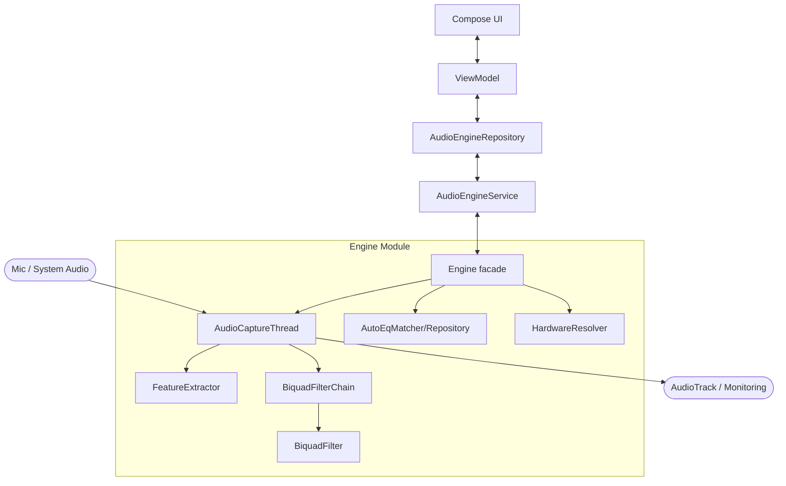

# Winton Hills V2 — Project Analysis Report

_Date: 2026-07-25_

This report provides a comprehensive overview of the **Winton Hills V2** Android project, based on an exhaustive study of its architecture, source code, and assets.

## 1. Executive Summary

Winton Hills V2 is an Android multi-module project designed as a validation shell for a real-time audio engine SDK. It features a sophisticated audio processing pipeline implemented in pure Kotlin (with JNI stubs for future native optimization), capable of capturing live audio (microphone or system-wide), analyzing its content (RMS, spectral centroid, classification), and applying dynamic EQ policies including headphone-specific corrections via an integrated AutoEq database.

## 2. Architecture & Module Breakdown

The project follows a clean, decoupled architecture split into two main modules:

### A. `:app` (Validation Shell)
The user-facing application that provides controls and visualization for the engine.
- **UI:** Built with **Jetpack Compose**, featuring real-time telemetry updates.
- **Lifecycle Management:** Uses a **Foreground Service** (`AudioEngineService`) to ensure audio processing continues while the app is in the background.
- **Pattern:** Follows **MVVM** with `ValidationShellViewModel` managing UI state and interacting with the engine via a repository.
- **Key Features:** Engine start/stop, A/B mode toggle, policy selection (Auto, Speech, Neutral), AutoEq profile search and application, and session logging (CSV export).

### B. `:engine` (Audio SDK)
The core library responsible for all audio logic.
- **Engine Core:** `Engine.kt` acts as a facade, coordinating capture, analysis, and processing.
- **Audio Capture:** `AudioCaptureThread.kt` handles high-priority PCM capture from `AudioRecord` (supporting both Mic and `MediaProjection` for system audio).
- **DSP Pipeline:** Implements a serial `BiquadFilterChain` using the RBJ Audio EQ Cookbook formulas. Features smooth coefficient ramping (50ms) to prevent audible pops.
- **Analysis:** `FeatureExtractor.kt` computes RMS and Spectral Centroid (via a custom radix-2 FFT) to classify audio into Speech, Music, or Silence.
- **AutoEq:** Includes a database of **6,017 profiles** (`autoeq_profiles.json`) with a tiered fuzzy matching algorithm for headphone-specific EQ.

## 3. Data Flow

## 4. Key Components & Technologies

| Component | Technology | Description |
| :--- | :--- | :--- |
| **UI** | Jetpack Compose | Modern declarative UI with Material 3. |
| **Audio Capture** | `AudioRecord` | Low-latency capture, including `MediaProjection` for system audio (API 29+). |
| **Audio Output** | `AudioTrack` | Real-time monitoring of processed audio. |
| **DSP** | Kotlin IIR Filters | 2nd-order Biquad filters with linear ramping. |
| **FFT** | Radix-2 (Kotlin) | custom implementation for spectral analysis. |
| **Matching** | Levenshtein Distance | Fuzzy search for headphone profiles. |
| **Service** | Foreground Service | Ensures persistent processing and handles Audio Focus. |

## 5. Phase-1 Status & Observations

- **Readiness:** The project is estimated at **~94% completion** for Phase-1.
- **Stability:** Significant effort has been put into thread safety (volatiles, synchronization) and pop-free transitions.
- **Native Path:** The JNI/C++ layer exists as a stubbed surface, allowing for future migration to a full Oboe/Native DSP backend without changing the public Kotlin API.
- **Hardware Aware:** The engine resolves specific profiles based on the output route (Bluetooth vs. Wired vs. Speaker).

## 6. Recommendations for Future Work

1.  **Native Migration (Phase-2):** Implement the full DSP chain in C++ for better performance and lower latency.
2.  **ML Classification:** Replace the current heuristic-based classifier with a small TFLite model for more robust Speech/Music detection.
3.  **Expanded Filter Support:** Add support for `LOW_SHELF` and `HIGH_SHELF` filters (currently only `PEAK` is applied).
4.  **UI Enhancements:** Add real-time spectrum visualization using the FFT data already available in the engine.

---
> [!NOTE]
> This analysis is based on the source code as of 2026-06-11 updates.
